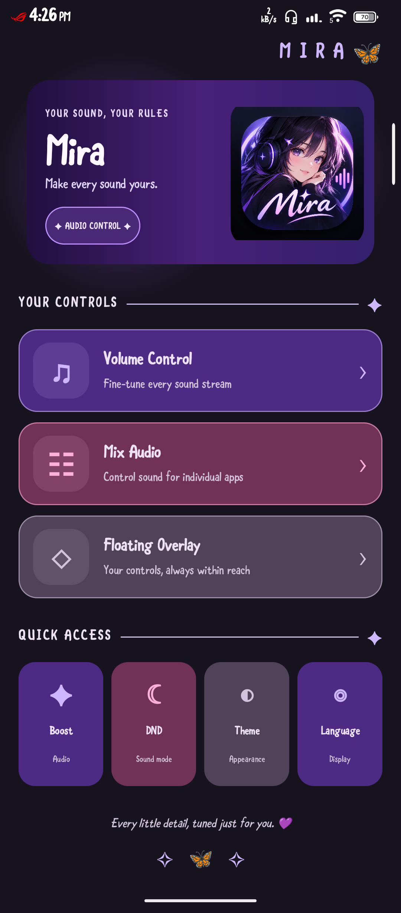
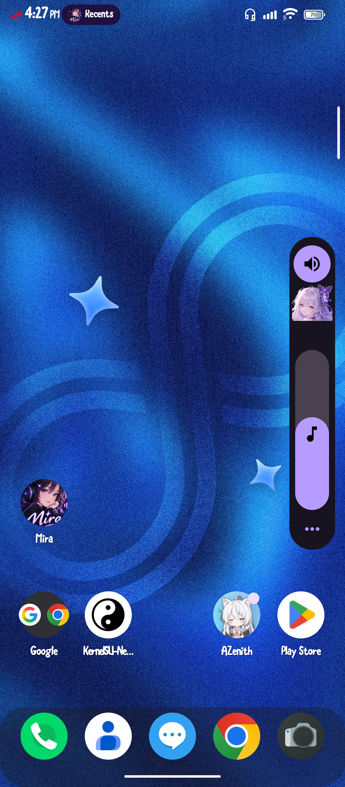
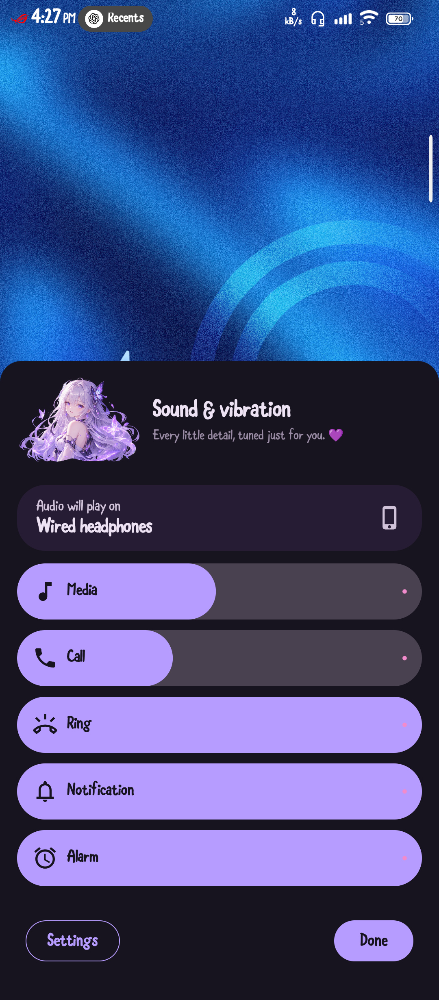
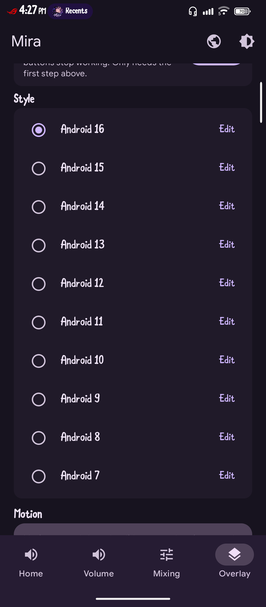

# Mira Volume 🦋

**A more personal look for your Android volume controls.**

Mira Volume is an Android volume-control customization project based on
the Volume++ project. It combines a customizable floating volume panel
with system-volume controls, optional per-app audio features, and
Mira-themed visuals.

> **Project status:** This repository is being prepared for its first
> Mira Volume release. Features may behave differently across Android
> versions and device manufacturers.

## Screenshots

| Mira Home | Floating Volume Overlay |
|---|---|
|  |  |

| System Volume Panel | Overlay Settings |
|---|---|
|  |  |

Additional screenshots:
- [Mira Home — light theme](docs/screenshots/mira-home-light.png)
- [Floating overlay — light theme](docs/screenshots/mira-overlay-light.png)
- [Volume controls](docs/screenshots/mira-volume-controls.png)

## Features

### Custom volume panel

- Floating panel designed to replace the standard volume interface.
- Multiple panel designs inspired by Android versions 7 through 16.
- Controls for supported system audio streams.
- Hardware volume-key handling, including press-and-hold adjustment.
- Customizable panel positioning and colors.

### Personalization

- Mira-themed interface and butterfly artwork.
- Separate position and color settings for supported panel styles.
- Screen color picker for sampling colors from other content.
- Motion and haptic settings for supported interactions.
- English, Spanish, Portuguese, and French interface strings.

### Audio features

- Per-app playback-volume controls where supported by Android and
  available privileged access.
- Optional audio-focus controls that can allow an app to continue
  playing when another app starts audio.
- Optional media-volume booster, disabled by default.
- Options for remembering per-app volume preferences.
- Quick Settings tile for opening the panel on supported setups.

Feature availability depends on Android version, device behavior,
permissions, and privileged-service availability. Audio mixing can
interfere with an app's normal pause, resume, or media-control behavior.

## Requirements and permissions

Mira Volume targets Android 16 and declares Android 7.0 (API 24) as
its minimum Android version. Actual feature availability varies by
device and operating system.

Depending on the features you use, the app may request:

- **Accessibility access:** hardware volume-key handling.
- **Display over other apps:** drawing the floating panel.
- **Shizuku or root access:** supported privileged audio operations.
- **Notification-policy access:** applicable ringer and notification
  volume behavior.
- **Screen-capture permission:** screen color picking.

Grant only the permissions required for the features you want.

### Shizuku and root

Some audio operations require privileges unavailable to ordinary apps.

- **Shizuku:** requires the Shizuku app, its service running through a
  supported ADB or wireless-debugging setup, and authorization.
- **Root:** may work through a compatible root solution.

Neither option is guaranteed to work on every device. Non-privileged
volume controls may remain available without either option.

### Audio mixing limitations

Audio-focus behavior varies by app and Android version.
Mixing may affect playback controls or pause/resume behavior.
Disable mixing if an app behaves unexpectedly.

The optional media booster may cause clipping or loud audio.
It is disabled by default. Protect your hearing.

## Installation

Download the APK from this repository's GitHub Releases page
when an official release is published.

## Build from source

Mira Volume is a Gradle-based Android project.

### Prerequisites

- A compatible Java Development Kit.
- Android SDK platform and build tools.
- Access to the required Gradle dependencies.

The Gradle wrapper is included in the repository.

### Build a debug APK

Run this command from the repository root:

```bash
bash ./gradlew assembleDebug
```

The debug APK is normally generated at:

`app/build/outputs/apk/debug/app-debug.apk`

## Technical overview

- **Language:** Kotlin
- **In-app UI:** Jetpack Compose and Material 3
- **Floating overlay:** Android views and WindowManager
- **Privileged communication:** Android Interface Definition Language (AIDL)
- **Asynchronous operations:** Kotlin coroutines

Some features depend on Android system services and privileged access.

## Translations

Mira Volume currently includes interface strings for:

- English
- Spanish
- Portuguese
- French

See [the translation guide](docs/TRANSLATING.md) for contribution guidance.

## Credits and license

Mira Volume is based on the Volume++ project. Original project attribution is preserved in the LICENSE file.

This project is distributed under the MIT License. See [LICENSE](LICENSE) for the full license text.
